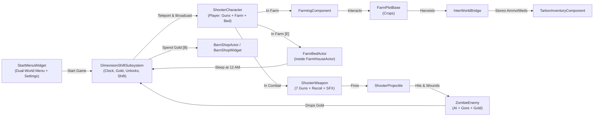

# GameJam Shift 2026 — Complete Codebase Guide (Teacher-to-Student Edition)

Welcome! This document explains **every single script in your game** — all **3 C# build files**, all **41 C++ modules (80 `.h`/`.cpp` files)**, and all **26 Python editor/audio scripts** — without skipping a single one.

It is written like a programming teacher walking a student who is learning **C++ and Unreal Engine** through a real, shipping game.

---

## Part 0: A 5-Minute C++ & Unreal Engine Primer

Before we dive into every file, here are the 8 core C++ / Unreal concepts you will see over and over again in this project:

1. **Header (`.h`) vs. Implementation (`.cpp`)**
   - Think of a `.h` file like a **restaurant menu**: it lists *what* a class has (its variables and function names) so other files know what exists.
   - Think of a `.cpp` file like the **kitchen**: it has the actual step-by-step C++ recipe (logic) for every function listed in the `.h` file.
2. **Classes & Inheritance (`class A : public B`)**
   - Inheritance means "Class A is a specialized version of Class B."
   - For example, `AZombieEnemy : public AShooterNPC : public ACharacter : public APawn : public AActor`. Because `AZombieEnemy` inherits from `ACharacter`, it automatically gets movement, gravity, a collision capsule, and a skeletal mesh without rewriting any of that code!
3. **Unreal Naming Prefixes**
   - `A` = **Actor** (something that can be placed in a 3D level, like `AFarmBedActor` or `AZombieEnemy`).
   - `U` = **UObject / Component / Widget / Subsystem** (things that attach to Actors or live in memory/UI, like `UFarmingComponent` or `UGoldHUDWidget`).
   - `F` = **Struct** (a lightweight bundle of data, like `FVector` for `(X, Y, Z)` or `FCropHarvestData`).
   - `E` = **Enum** (a fixed list of named choices, like `EGameDimension::Combat` vs `EGameDimension::Farming`).
   - `I` = **Interface** (a contract of functions a class promises to implement, like `IShooterWeaponHolder`).
4. **Pointers (`*` and `TObjectPtr<T>`) & Null Checks**
   - A pointer holds the **memory address** of another object instead of copying the whole object.
   - Because a pointer might point to nothing (`nullptr`), you will constantly see `if (Weapon) { Weapon->Fire(); }` — the `->` arrow means "follow the pointer to the object and call its function."
5. **`UPROPERTY(...)` and `UFUNCTION(...)` Macros**
   - Plain C++ doesn't know about Unreal's Editor or Blueprints. Adding `UPROPERTY(EditAnywhere, BlueprintReadWrite)` above a variable tells Unreal's **Unreal Header Tool (UHT)** to expose it in the Editor Details panel and protect it from garbage collection.
6. **Delegates (`OnDimensionShifted`, `OnGoldChanged`)**
   - A delegate is like a **radio broadcast**. When `UDimensionShiftSubsystem` shifts worlds, it calls `OnDimensionShifted.Broadcast(...)`. Any class listening (like `AShooterCharacter` or UI widgets) automatically reacts, without the subsystem needing to hardcode every listener!
7. **Subsystems (`UGameInstanceSubsystem`)**
   - A `UGameInstanceSubsystem` is a **singleton manager** that Unreal creates automatically when the game starts and keeps alive the whole session. Our `UDimensionShiftSubsystem` is the "brain" holding your Gold, 24-hour clock, Developer Mode, weapon unlocks, and world-shifting logic.
8. **How the Two Worlds Actually Work**
   - Both worlds live in the **same 3D coordinate space**, separated by **5 kilometers horizontally and 200 meters vertically**:
     - **Combat / Zombie World (`Lvl_Combat`)** is centered at `(0, 0, 0)`.
     - **Farming World (`Lvl_Farm`)** is streamed in at `FarmWorldOffset = (500000, 0, -20000)`.
   - Shifting dimensions teleports the player between them, swaps the sun/sky/fog visibility, and switches controls from Guns to Farming Tools!

---

## Part 1: Build & Target Scripts (C# — `Source/`)

Unreal Engine uses C# files (`.Build.cs` and `.Target.cs`) to tell **UnrealBuildTool (UBT)** how to compile your C++ code into a Windows DLL/EXE.

### 1. `Source/GameJam_Shift_2026/GameJam_Shift_2026.Build.cs`
- **What it does:** The "shopping list" of Unreal Engine libraries your C++ module needs.
- **How it works:** Adds engine modules (`Core`, `Engine`, `EnhancedInput`, `AIModule`, `StateTreeModule`, `UMG`, `Slate`, `Niagara`, `NavigationSystem`) and registers include folders (`Dimension`, `Farming`, `InterWorld`, `Variant_Shooter`, etc.) so your `.cpp` files can `#include` headers cleanly without long relative paths.

### 2. `Source/GameJam_Shift_2026.Target.cs`
- **What it does:** Build recipe for a standalone packaged **Game** executable (`.exe`).
- **How it works:** Sets `Type = TargetType.Game`, enables Unreal 5.7 build settings (`BuildSettingsVersion.V6`), and includes the `GameJam_Shift_2026` module.

### 3. `Source/GameJam_Shift_2026Editor.Target.cs`
- **What it does:** Build recipe for the **Unreal Editor** version of your project (`UnrealEditor-GameJam_Shift_2026.dll`).
- **How it works:** Identical to `GameJam_Shift_2026.Target.cs` except `Type = TargetType.Editor`, which compiles editor-only tools and hooks so you can press Play-In-Editor (PIE).

---

## Part 2: Core Module & Base Character Template (`Source/GameJam_Shift_2026/`)

These 5 class pairs form the foundation that `Variant_Shooter` builds on top of.

### 4. `GameJam_Shift_2026.h` & `GameJam_Shift_2026.cpp`
- **What it does:** Registers the C++ module with Unreal Engine and defines the project's custom log category (`LogGameJam_Shift_2026`).
- **How it works:** `IMPLEMENT_PRIMARY_GAME_MODULE` tells Unreal "this DLL is the main game." `DECLARE_LOG_CATEGORY_EXTERN` / `DEFINE_LOG_CATEGORY` lets every script print tagged debug messages via `UE_LOG(LogGameJam_Shift_2026, Log, ...)`.

### 5. `GameJam_Shift_2026CameraManager.h` & `.cpp`
- **What it does:** Clamps how far up and down the first-person camera can look.
- **How it works:** Inherits from `APlayerCameraManager` and sets `ViewPitchMin = -70.0f` and `ViewPitchMax = 80.0f` in its constructor so the player can't flip their neck upside down.

### 6. `GameJam_Shift_2026Character.h` & `.cpp`
- **What it does:** The base First-Person Player Character class (parent of `AShooterCharacter`).
- **How it works:** Creates the collision capsule, the `FirstPersonMesh` (arms visible only to the player via `SetOnlyOwnerSee(true)`), and the `FirstPersonCameraComponent` attached to the `"head"` socket. Binds Enhanced Input actions for moving (`WASD`), looking (mouse), and jumping (`Space`) via `MoveInput`, `LookInput`, `DoMove`, `DoAim`, `DoJumpStart`, and `DoJumpEnd`.

### 7. `GameJam_Shift_2026GameMode.h` & `.cpp`
- **What it does:** The default Unreal template GameMode stub (superseded by `AShooterGameMode` in our playable levels).
- **How it works:** Empty `AGameModeBase` subclass provided by Unreal's First-Person C++ template.

### 8. `GameJam_Shift_2026PlayerController.h` & `.cpp`
- **What it does:** Base PlayerController that registers the default Enhanced Input Mapping Contexts and camera manager.
- **How it works:** Assigns `AGameJam_Shift_2026CameraManager` in its constructor, and in `SetupInputComponent()` attaches the `DefaultMappingContexts` to the player's `UEnhancedInputLocalPlayerSubsystem`.

---

## Part 3: Dimension Shift & 24-Hour Clock System (`Source/GameJam_Shift_2026/Dimension/`)

This folder is the **heart of the dual-world mechanic**, day/night cycle, economy state, and user settings.

### 9. `Dimension/DimensionTypes.h`
- **What it does:** Shared data types for the dimension system (header-only, no `.cpp` needed).
- **How it works:** Defines `enum class EGameDimension : uint8 { Combat, Farming }` and declares the multicast delegate `FOnDimensionShifted(EGameDimension NewDimension, FVector TargetLocation)` so other classes can subscribe to world shifts.

### 10. `Dimension/DimensionShiftSubsystem.h` & `.cpp`
- **What it does:** The master **GameInstanceSubsystem** that controls almost all cross-world state:
  1. **Level Streaming:** Loads `Lvl_Farm` at `FarmWorldOffset = (500000, 0, -20000)` (5 km away so `Lvl_Combat` never casts a shadow on the Farm!) and auto-spawns `ABarnShopActor` and `AFarmHouseActor` inside `HandleFarmLevelShown()`.
  2. **Game Start (`TeleportToFarmStart`):** Places the player in the sunlit Farm at `06:00 AM` when starting a new game.
  3. **Safe Shifting (`CanShiftSafely`, `RequestShift`):**
     - **Farm → Combat:** Requires `12:00 AM–6:00 AM` AND sleeping in the farmhouse bed. Always teleports to the center of `Lvl_Combat` `(0, 0)` (with radial fallback spots if a zombie stands on `(0, 0)`).
     - **Combat → Farm:** Unlocks at `06:00 AM`. Teleports directly back into the exact bed sleeping anchor so the player wakes up in the same 90° lying pose.
  4. **24-Hour Clock & Farm-Only Sun (`TickDayNightClock`, `UpdateFarmSunForTimeOfDay`):**
     - `06:00 → 24:00` (18 in-game hrs) takes **5 real minutes** (300s).
     - `00:00 → 06:00` (6 in-game hrs) takes **3 real minutes** (180s).
     - Rotates and tints **only** the Farm's `DirectionalLight` (tagged `"FarmWorld"`), never touching Combat lighting.
  5. **Gold Economy & Weapon Unlocks:** Tracks `CurrentGold` (starts at `2000G`), `AddGold()`, `SpendGold()`, and `UnlockedWeaponSlots` (Slot 0 M1911 free; Slots 1–6 buyable in the Barn Shop).
  6. **Settings & Developer Mode:** Stores `MasterVolume`, `MouseSensitivity`, and `bDeveloperMode` (all 7 guns + infinite Gold + infinite Ammo + `[+]` key advances 1 real minute).
- **C++ Teaching Note:** Notice how `const` methods like `CanShiftSafely(...) const` promise not to modify class data, and `TWeakObjectPtr<T>` safely points to actors (`LastSleptBed`, `FarmLevelStreaming`) without preventing Unreal from garbage-collecting them if a level unloads!

### 11. `Dimension/DimensionShiftCameraShake.h` & `.cpp`
- **What it does:** Procedural C++ camera shakes for Dimension Shifting and Zombie Hits (no Blueprint asset required!).
- **How it works:** Defines two classes inheriting from `UCameraShakeBase`:
  - `UDimensionShiftCameraShake`: A snappy `0.38s` rotational/positional burst when teleporting worlds.
  - `UHitCameraShake`: A quick `0.24s` rotational jolt when a zombie lands a melee hit.
  - Uses `FPerlinNoiseShaker` wave oscillators inside `UDimensionShiftCameraShakePattern` so the shake feels organic.

---

## Part 4: Farming World System (`Source/GameJam_Shift_2026/Farming/`)

Everything that makes the sunlit Farming dimension interactive: tools, soil plots, crops, the Barn Shop, the Farmhouse, the Bed, and the Farming HUD.

### 12. `Farming/FarmingTypes.h`
- **What it does:** Shared enums and structs for farming (header-only).
- **How it works:** Defines `EFarmTool` (`None`, `Hoe`, `WateringCan`, `Harvester`), `ECropStage` (`Empty`, `Planted`, `Sprout`, `Growing`, `Mature`, `Withered`), and `FCropHarvestData` (what item ID, quantity, and bonus seeds a mature crop gives).

### 13. `Farming/FarmingComponent.h` & `.cpp`
- **What it does:** An `UActorComponent` attached to `AShooterCharacter` that owns all player farming abilities.
- **How it works:**
  - Tracks `CurrentTool` (`Hoe`, `WateringCan`, `Harvester`), `SelectedSeedID`, `SeedInventory` (`TMap<FName, int32>` — a dictionary mapping seed name → count), and `FarmPlotInventoryCount`.
  - `PerformPrimaryFarmAction()`: Casts a line trace (`LineTraceSingleByChannel`) from the camera to see what `AFarmPlotBase` you're looking at, then either tills/plants (Hoe), waters (Watering Can), or harvests (Harvester).
  - **Live Plot Placement Mode:** When you buy a Farm Plot from the Barn Shop, spawns a translucent green/red ghost preview (`PlotPreviewMesh`) snapped to the ground; left-clicking places a real `AFarmPlotBase`, right-clicking cancels.
  - Manages the Farming HUD widgets (`UFarmingToolBarWidget`, `UPlotTooltipWidget`, `UHarvestPopupWidget`).

### 14. `Farming/FarmPlotBase.h` & `.cpp`
- **What it does:** An individual 3D soil plot actor in the Farm that grows crops over time.
- **How it works:**
  - Holds a state machine (`CurrentStage`: `Empty → Planted → Sprout → Growing → Mature`).
  - `PlantSeed(FName SeedID)` dynamically configures the plot's `HarvestYield`, `HarvestFloatingText`, and mature 3D mesh (`Mesh_Mature`) based on which seed was planted (Pistol Vine, Shotgun Corn, Rifle Wheat, or Medkit Herb).
  - `WaterPlot()` marks the soil wet (darkens soil material) and starts a growth timer (`FTimerHandle`) that advances stages automatically with a bouncy scale-pop animation and harvest sound.
  - `HarvestPlot(AActor* Harvester)` calls `UInterWorldBridge::DepositHarvestToInventory()` to put ammo/medkits directly into your Tarkov backpack and resets the plot to `Empty`.

### 15. `Farming/BarnShopActor.h` & `.cpp`
- **What it does:** The physical wooden shop counter in front of the Red Barn in `Lvl_Farm`.
- **How it works:** Uses a `UBoxComponent` (`InteractionBox`) with `OnComponentBeginOverlap` / `OnComponentEndOverlap` to detect when the player walks up, displays a floating `"BARN SHOP [B]"` `UTextRenderComponent`, and opens `UBarnShopWidget` when `OpenBarnShop()` is called.

### 16. `Farming/BarnShopWidget.h` & `.cpp`
- **What it does:** The interactive 2-tab Barn Shop UI (`FARM SUPPLIES` tab + `GUNS ARSENAL` tab).
- **How it works:** Built 100% in C++ using Unreal's `WidgetTree->ConstructWidget<T>()` (no Blueprint widget needed!).
  - **Farm Supplies tab:** Buy Pistol/Shotgun/Rifle/Medkit seeds and placeable Farm Plots using Gold.
  - **Guns Arsenal tab:** Buy and permanently unlock the 6 upgrade guns (`M1911 Tactical` `1000G` up to `FN SCAR-H` `6000G`), calling `UDimensionShiftSubsystem::SpendGold()` and `UnlockWeapon()`.

### 17. `Farming/FarmHouseActor.h` & `.cpp`
- **What it does:** The cozy walkable Farmhouse spawned automatically beside the Barn in `Lvl_Farm`.
- **How it works:** Procedurally assembles primitive cube meshes (`Floor`, 4 walls with a wide `200x250 cm` doorway, `PorchStep`, `Ceiling`, pitched `RoofLeft`/`RoofRight`), colors them with `UMaterialInstanceDynamic`, adds a warm interior `UPointLightComponent` + `"FARMHOUSE"` sign, and spawns an `AFarmBedActor` inside on `BeginPlay()`.

### 18. `Farming/FarmBedActor.h` & `.cpp`
- **What it does:** The interactive Bed inside the Farmhouse that gates shifting to the Zombie World.
- **How it works:** Builds the bed frame, headboard, footboard, white mattress, crimson blanket, pillow, a visibility-blocking `InteractionBox` (so the player's camera raycast hits it reliably), and a `"[E] SLEEP"` sign. Exposes `GetSleepAnchorLocation()`, `GetWakeUpLocation()`, and `GetSleepFacingRotation()` for the 90° Minecraft-style sleep pose.

### 19. `Farming/FarmingHUDWidgets.h` & `.cpp`
- **What it does:** Contains 3 UMG HUD widgets used while in the Farming dimension:
  1. `UFarmingToolBarWidget`: Bottom-center hotbar showing `[1] Hoe`, `[2] Watering Can`, `[3] Harvester`, `[4] Place Plot`, and the currently selected seed (`[T]` to cycle).
  2. `UPlotTooltipWidget`: Center-screen hover tooltip showing the crop name, growth stage, watered status, and next action when looking at a `AFarmPlotBase`.
  3. `UHarvestPopupWidget`: Floating `"+24 Rifle Ammo"` notification that drifts upward and fades out over `1.5s`.

---

## Part 5: InterWorld Economy Bridge & Persistent UI (`Source/GameJam_Shift_2026/InterWorld/`)

Scripts that connect both worlds together (economy, HUD clock, and Start/Settings menu).

### 20. `InterWorld/InterWorldBridge.h` & `.cpp`
- **What it does:** A `UBlueprintFunctionLibrary` (collection of `static` utility functions) bridging Farm harvests to your Combat Tarkov Backpack.
- **How it works:** Translates crop item IDs (`"Item_Ammo_Pistol"`, `"Item_Ammo_Shotgun"`, `"Item_Ammo_Rifle"`, `"Item_Medkit"`) into display names, max stack sizes, and grid dimensions, then calls `DepositHarvestToInventory`, `ConsumeItemFromInventory`, `GetTotalItemCountInInventory`, or `UseMedkitFromInventory` (heals `+50 HP` on `[H]`).
- **C++ Teaching Note:** Because all functions are `static`, any file can call `UInterWorldBridge::UseMedkitFromInventory(this, 50.0f)` without creating an instance of the class!

### 21. `InterWorld/GoldHUDWidget.h` & `.cpp`
- **What it does:** The persistent overlay HUD visible in both dimensions:
  - **Top-Right:** Live Gold counter (`2000 G`) with animated `+100 G` / `-1000 G` delta popups.
  - **Middle-Right:** Live **24-Hour Clock** (`06:00` / `6:00 AM`, `DAY 1`, Farm/Zombie phase badge, and shift/sleep unlock status).
  - **Exact Center:** Auto-hiding notification banner (`ShowCenterNotification()`) used for the 2-second `"It's work time! Sleeping is from 12 AM."` alert and sleep/shift prompts.
- **How it works:** Subscribes to `UDimensionShiftSubsystem::OnGoldChanged` and ticks `RefreshClockDisplay()` and `NotificationTimeRemaining` every frame in `NativeTick()`.

### 22. `InterWorld/StartMenuWidget.h` & `.cpp`
- **What it does:** The horizontally split live 3D **Dual-Dimension Start Menu** (also reused as the `[P]` in-game Settings menu).
- **How it works:**
  - Spawns two live `USceneCaptureComponent2D` cameras rendering into `UTextureRenderTarget2D` textures: the top half pans over the sunlit Farm (anchored to `FarmWorldOffset` with fog disabled and dedicated fill lights), while the bottom half orbits the dark Zombie Compound.
  - Provides **START GAME** (calls `TeleportToFarmStart()` on fresh start), **SETTINGS** (Master Volume slider, Mouse Sensitivity slider, Developer Mode toggle), and **QUIT**.

---

## Part 6: Shooter Player, GameMode & Controller (`Source/GameJam_Shift_2026/Variant_Shooter/`)

### 23. `Variant_Shooter/ShooterCharacter.h` & `.cpp`
- **What it does:** The **main playable character** — inherits from `AGameJam_Shift_2026Character` and implements `IShooterWeaponHolder`.
- **How it works:** This is the central hub connecting player input to every system:
  - **Combat:** Spawns all 7 Gun Pack weapons (`M1911`, `M1911 Tactical`, `MP5`, `MP7`, `M4A1`, `M16`, `SCAR`), handles firing (`LMB`), reloading (`R`), 7-slot Weapon Wheel (`Hold Tab` or `1`–`7`), Tactical Flashlight (`F`), Medkit (`H`), HP/Damage/Death/Respawn, and hit camera shake.
  - **Farming & Bed:** Owns `UFarmingComponent` and `UTarkovInventoryComponent`. Routes `E` through `InteractOrCycleToolNext()` (raycasts for `AFarmBedActor` → either shows the 2-second work-time notice or enters 90° world-space Minecraft-style bed sleep via `EnterBedSleep` / `ExitBedSleep`).
  - **Dimension Shifting:** Routes `Left Shift` to `UDimensionShiftSubsystem::RequestShift()`, plays shift VFX/SFX/glitch post-process in `HandleOnDimensionShifted()`, swaps `IMC_Weapons` ↔ `IMC_Farming`, and ticks the 24-hour clock.

### 24. `Variant_Shooter/ShooterGameMode.h` & `.cpp`
- **What it does:** Manages the active game match rules and score UI.
- **How it works:** Creates `UShooterUI` in `BeginPlay()` and tracks team scores (`IncrementTeamScore`) when NPCs/zombies are defeated.

### 25. `Variant_Shooter/ShooterPlayerController.h` & `.cpp`
- **What it does:** The player's controller — creates and owns the persistent HUD widgets (`UShooterBulletCounterUI`, `UGoldHUDWidget`, `UStartMenuWidget`), handles `[P]` to open Settings, and respawns the player character if killed (`OnPawnDestroyed`).

---

## Part 7: Weapons, Projectiles & Pickups (`Source/GameJam_Shift_2026/Variant_Shooter/Weapons/`)

### 26. `Variant_Shooter/Weapons/ShooterWeaponHolder.h` & `.cpp`
- **What it does:** A pure C++ **Interface** (`IShooterWeaponHolder`) defining what any gun owner (player or AI) must be able to do.
- **How it works:** Declares pure virtual functions (`= 0`) like `AttachWeaponMeshes`, `PlayFiringMontage`, `AddWeaponRecoil`, `UpdateWeaponHUD`, and `GetWeaponTargetLocation`. Because `AShooterWeapon` talks to `IShooterWeaponHolder` instead of hardcoding `AShooterCharacter`, both players and NPCs can use the exact same weapon code!

### 27. `Variant_Shooter/Weapons/ShooterWeapon.h` & `.cpp`
- **What it does:** The universal gun class powering all **7 weapons** (M1911 Classic, M1911 Tactical, MP5, MP7, M4A1, M16, FN SCAR-H).
- **How it works:**
  - Configures each gun's 3D static mesh (`FirstPersonGunMesh`), PBR materials, fire rate (`RefireRate`), full-auto vs. semi-auto (`bFullAuto`), magazine size, damage, and per-shot gunshot SFX (`FireSound` synced 1:1 with every bullet).
  - Drives smooth **procedural 3D animations** in `Tick()`: quaternion-composed recoil kickback, 3-stage tilt-and-rack reload animation, draw/equip rise animation, and a 3D crossed-starburst muzzle flash + point light.
  - Handles magazine tracking, Tarkov backpack ammo consumption on reload, and **Developer Mode infinite ammo**.

### 28. `Variant_Shooter/Weapons/ShooterProjectile.h` & `.cpp`
- **What it does:** The fast invisible ballistic bullet actor spawned when a gun fires.
- **How it works:** Uses `USphereComponent` + `UProjectileMovementComponent`. On impact (`NotifyHit`), applies point damage (`UGameplayStatics::ApplyDamage`), calls `AZombieEnemy::ApplyBulletWound()` for 3D gore & blood bursts, and destroys itself cleanly.

### 29. `Variant_Shooter/Weapons/ShooterPickup.h` & `.cpp`
- **What it does:** A world pickup actor (from the Shooter template) that grants a weapon class when overlapped and respawns after a cooldown timer.

---

## Part 8: Zombies & AI System (`Source/GameJam_Shift_2026/Variant_Shooter/AI/`)

### 30. `Variant_Shooter/AI/ZombieEnemy.h` & `.cpp`
- **What it does:** The melee Zombie enemy in `Lvl_Combat` — inherits from `AShooterNPC`.
- **How it works:**
  - **Custom AI State Machine in `Tick()`:** Ignores the player when they're in the Farm (`Z < -10000`). Uses cone-of-vision + line-of-sight checks (`DetectionRange`, `SightHalfAngle`) to switch between **Roaming** (picking random NavMesh points), **Chasing**, and **Melee Attacking** (plays `SFX_ZombieBiteHit` and deals melee damage).
  - **Speed-Matched Animations:** Dynamically scales walk/run animation play rate to match actual ground speed so feet never slide.
  - **Tom Looman-Style 3D Gore (`ApplyBulletWound`):** Updates 4 hit-sphere slots (`HitPos0..3`) on the zombie's dynamic skin material (`M_ZombieMaster`) so bullet holes appear at the exact 3D impact point, plus spawns arterial blood droplets and ground blood pools!
  - **Death & Economy:** Plays sped-up death animation and awards `KillGoldReward` (`100G`) via `UDimensionShiftSubsystem::AddGold()`.

### 31. `Variant_Shooter/AI/ShooterNPC.h` & `.cpp`
- **What it does:** Base AI character class (parent of `AZombieEnemy`) implementing `IShooterWeaponHolder`.
- **How it works:** Manages `CurrentHP`, `TakeDamage()`, `Die()` (ragdoll + `OnPawnDeath` delegate), and ranged weapon firing for template shooter bots.

### 32. `Variant_Shooter/AI/ShooterNPCSpawner.h` & `.cpp`
- **What it does:** Spawner actor placed around `Lvl_Combat` that spawns zombies and respawns new ones after a delay when previous ones die.
- **How it works:** Binds to each spawned NPC's `OnPawnDeath` delegate (`OnNPCDied`) and schedules a `FTimerHandle` to spawn the next wave/replacement up to `SpawnCount`.

### 33. `Variant_Shooter/AI/ShooterAIController.h` & `.cpp`
- **What it does:** AI controller using `UAIPerceptionComponent` (sight) and `UStateTreeAIComponent` to drive `AShooterNPC` behavior.

### 34. `Variant_Shooter/AI/ShooterStateTreeUtility.h` & `.cpp`
- **What it does:** Custom StateTree tasks and conditions (`FStateTreeLineOfSightToTargetCondition`, `FStateTreeShootAtTargetTask`, `FStateTreeFaceLocationTask`, `FStateTreeSenseEnemiesTask`, etc.) used by Unreal's StateTree AI graph.

### 35. `Variant_Shooter/AI/EnvQueryContext_Target.h` & `.cpp`
- **What it does:** An Environment Query System (EQS) context provider that tells AI spatial queries where the current enemy target is located.

---

## Part 9: Tarkov Inventory & Combat UI (`Source/GameJam_Shift_2026/Variant_Shooter/Inventory/` & `UI/`)

### 36. `Variant_Shooter/Inventory/TarkovInventoryComponent.h` & `.cpp`
- **What it does:** Your **Escape-from-Tarkov-style 2D grid backpack** (`6x5` cells) attached to `AShooterCharacter`.
- **How it works:**
  - Stores `TArray<FInventoryGridItem>` where each item has `(GridX, GridY, Width, Height, Quantity, MaxStackSize)`.
  - Implements collision-checked 2D bin-packing (`CanFitItemAt`, `FindFirstFreeSlot`, `TryAddItem`, `TryMoveItem`, `RemoveItem`) and supports rotating items 90° (`R` while dragging).
  - Opens/closes the inventory UI on `[I]` (or `[Tab]` in Farm).

### 37. `Variant_Shooter/UI/TarkovInventoryWidgets.h` & `.cpp`
- **What it does:** The drag-and-drop Tarkov Backpack UMG UI (`UTarkovInventoryWidget`, `UTarkovItemTileWidget`, `UTarkovGridCellWidget`, `UTarkovItemDragDropOp`).
- **How it works:** Draws the grid slots, color-coded item tiles with stack badges, and uses Unreal's `UDragDropOperation` so you can click-drag items between slots and press `R` to rotate them.

### 38. `Variant_Shooter/UI/ShooterWeaponWheelWidget.h` & `.cpp`
- **What it does:** The **`Hold TAB` 7-Slot Radial Weapon Wheel** in Combat.
- **How it works:** Places 7 weapon wedges in a circle using `cos(angle)` / `sin(angle)`, tracks the mouse angle from screen center (`FMath::Atan2`) to highlight the hovered gun, shows `[LOCKED]` for unbought guns (unless Developer Mode is ON), and equips the highlighted gun when you release `Tab`.

### 39. `Variant_Shooter/UI/ShooterBulletCounterUI.h` & `.cpp`
- **What it does:** The Combat HUD showing magazine ammo count, HP bar, and the **crimson blood-and-gore screen damage frame** (`T_BloodDamageOverlay`).
- **How it works:** When `AShooterCharacter::OnDamaged` fires, flashes the custom blood splatter texture around the screen border and smoothly fades its opacity back to `0` in `NativeTick()`.

### 40. `Variant_Shooter/UI/ShooterUI.h` & `.cpp`
- **What it does:** Minimal team-score HUD widget created by `AShooterGameMode` (exposes `BP_UpdateScore` for Blueprints).

---

## Part 10: Unused Template Variant (`Source/GameJam_Shift_2026/Variant_Horror/`)

These 4 class pairs came bundled with Unreal Engine 5.7's First-Person C++ Template. They are **not used by our game**, and are safe to ignore while studying our code:

- **41. `Variant_Horror/HorrorCharacter.h/.cpp`**: Template character with sprint stamina and flashlight.
- **42. `Variant_Horror/HorrorGameMode.h/.cpp`**: Template horror GameMode stub.
- **43. `Variant_Horror/HorrorPlayerController.h/.cpp`**: Template controller spawning `UHorrorUI`.
- **44. `Variant_Horror/UI/HorrorUI.h/.cpp`**: Template stamina bar widget.

---

## Part 11: Python Editor & Audio Automation Scripts (`Scripts/*.py`)

In Unreal Engine, Python scripts run **inside the Unreal Editor** (offline, at development time — never while the player is playing) to generate levels, import 3D models/audio, and build materials automatically so we don't have to click 1,000 buttons by hand!

### Level & Phase Builders
1. **`create_phase1_shift_assets.py`**: Creates the Dimension Shift VFX (`NS_DimensionPortal`), post-process glitch material (`M_PP_DimensionShift`), and camera shake/audio assets.
2. **`create_phase2_farm_level.py`**: Procedurally builds the entire `Lvl_Farm` map (terrain valley, Red Barn, Silo, 4x4 crop plots, pond, trees, fences, hay bales, and `"FarmWorld"` sun/sky/fog).
3. **`create_phase3_crops.py`**: Builds the 3D crop meshes and materials (`M_CropBase`) for Pistol Vine, Shotgun Corn, Rifle Wheat, and Medkit Herb across all growth stages.
4. **`create_phase5_zombie_combat.py`**: Builds the `Lvl_Combat` zombie quarantine compound, NavMesh bounds, lighting, zombie Blueprints (`BP_Zombie_Walker`, `BP_Zombie_Runner`), and `AShooterNPCSpawner` placements.
5. **`create_farming_hud_widgets.py`**: Creates/updates Blueprint HUD assets for farming tools and tooltips.
6. **`setup_dimension_shift_input.py`**: Creates the Enhanced Input Action (`IA_DimensionShift`) and wires it into the Input Mapping Contexts.

### Asset Importers (3D Models, Audio & Gore)
7. **`import_guns_pack.py`**: Batch-imports all 7 FBX gun models (`M1911`, `M1911Tactical`, `MP5`, `MP7`, `M4A1`, `M16`, `SCAR`) and builds their PBR materials (`MI_Gun_DarkSteel`, `MI_Gun_WalnutWood`, `MI_Gun_DesertTan`).
8. **`import_pistol_sfx.py`**: Imports the custom pistol gunshot MP3 and creates loudness/pitch-tuned `SFX_Pistol_Classic` and `SFX_Pistol_Tactical` SoundWaves.
9. **`import_auto_sfx.py`**: Extracts crisp single-shot transients from the 5 machine-gun MP3s and imports `SFX_Auto_MP5`, `SFX_Auto_MP7`, `SFX_Auto_M4A1`, `SFX_Auto_M16`, and `SFX_Auto_SCAR`.
10. **`import_zombie_assets.py`**: Imports the zombie skeletal mesh, skin textures, and FBX animation clips (Idle, Walk, Run, Attack, Death).
11. **`import_zombie_hit_fx.py`**: Imports `SFX_ZombieBiteHit` and procedurally generates + imports the crimson blood-and-gore damage border texture (`T_BloodDamageOverlay`).
12. **`build_zombie_wound_material.py`**: Programmatically builds the shader node graph for `M_ZombieMaster` with 4 Tom Looman-style 3D sphere-mask wound parameters (`HitPos0..3`).

### Procedural Audio Generators (Pure Python WAV Synthesis)
13. **`generate_shift_audio.py`**: Synthesizes the sci-fi whoosh/glitch WAV for `SFX_DimensionShift`.
14. **`generate_crop_pop_audio.py`**: Synthesizes the tactile pop/chime WAV when crops grow or get harvested.
15. **`generate_farm_ambience.py`**: Synthesizes gentle breeze/countryside ambience for the Farm.
16. **`generate_zombie_audio.py`**: Synthesizes zombie groans and combat atmosphere WAVs.

### Diagnostic, Fix & Verification Utilities
17. **`check_gun_direction.py`**: Inspects imported gun mesh bounding boxes to verify which axis the barrel points along (`+X` vs `-X`).
18. **`inspect_gun_props.py`**: Prints static mesh bounds and material slots of all 7 gun assets.
19. **`fix_zombie_bp_slots.py`**: Assigns `M_ZombieMaster` to every material slot on the zombie Blueprints.
20. **`fix_zombie_master_samplers.py`**: Ensures texture samplers inside `M_ZombieMaster` use the correct linear/sRGB sampler types.
21. **`inspect_zombie_anims.py`**: Prints duration, frame counts, and root-motion settings of imported zombie animations.
22. **`list_anim_api.py`**: Lists available Unreal Python API methods on `UAnimSequence` for scripting reference.
23. **`probe_anim_bones.py`**: Inspects bone names and root transforms on the zombie skeleton.
24. **`sample_stride.py`**: Measures foot-stride distance per second in zombie walk/run clips so `ReferenceAnimSpeed` matches zero-sliding locomotion.
25. **`verify_zombie_materials.py`**: Verifies all zombie Blueprints reference valid compiled materials with zero missing textures.
26. **`verify_zombie_runtime.py`**: Headless verification script checking zombie spawners, NavMesh, and AI properties in `Lvl_Combat`.

---

## Recommended Study Order for Learning C++ from This Project

If you want to read the actual code from easiest to most advanced, follow this order:
1. **Start with pure data (`enum` & `struct`):** `DimensionTypes.h` → `FarmingTypes.h`
2. **Simple Actors:** `FarmBedActor.h/.cpp` → `FarmHouseActor.h/.cpp` → `BarnShopActor.h/.cpp`
3. **Static Utility Functions:** `InterWorldBridge.h/.cpp`
4. **Interfaces & Inheritance:** `ShooterWeaponHolder.h` → `GameJam_Shift_2026Character.h/.cpp`
5. **State Machines & Timers:** `FarmPlotBase.h/.cpp` → `ZombieEnemy.h/.cpp`
6. **Subsystems & Delegates:** `DimensionShiftSubsystem.h/.cpp`
7. **UMG UI in C++:** `GoldHUDWidget.h/.cpp` → `ShooterWeaponWheelWidget.h/.cpp` → `BarnShopWidget.h/.cpp`
8. **Advanced Gameplay & Algorithms:** `ShooterWeapon.h/.cpp` → `TarkovInventoryComponent.h/.cpp` → `ShooterCharacter.h/.cpp`
