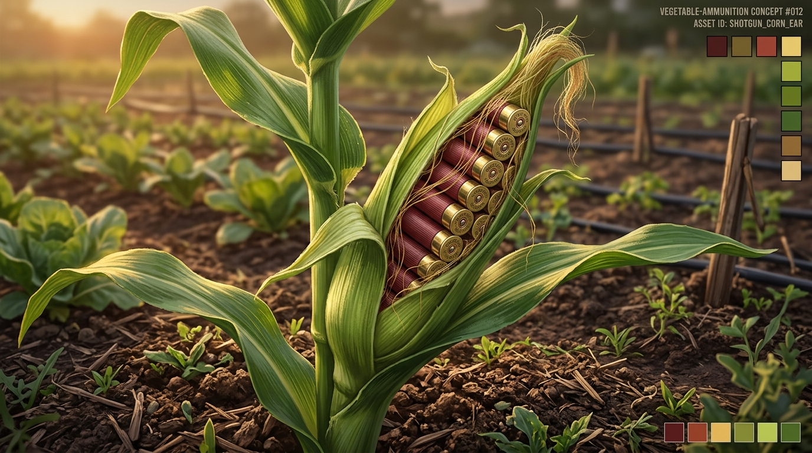
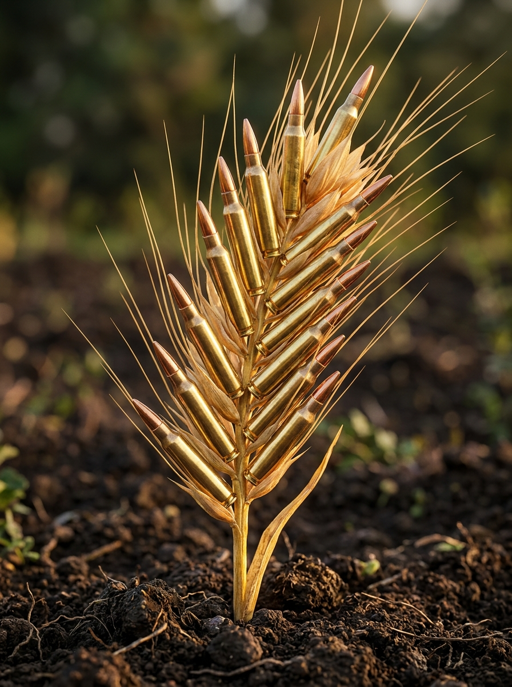
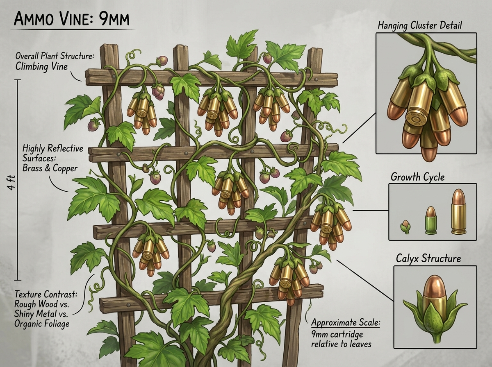
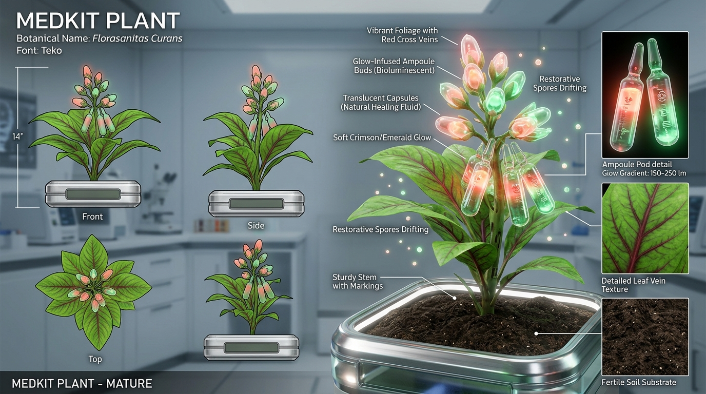
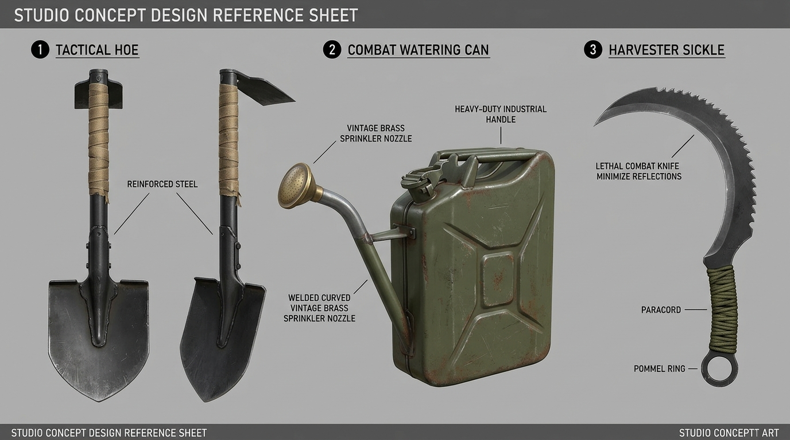
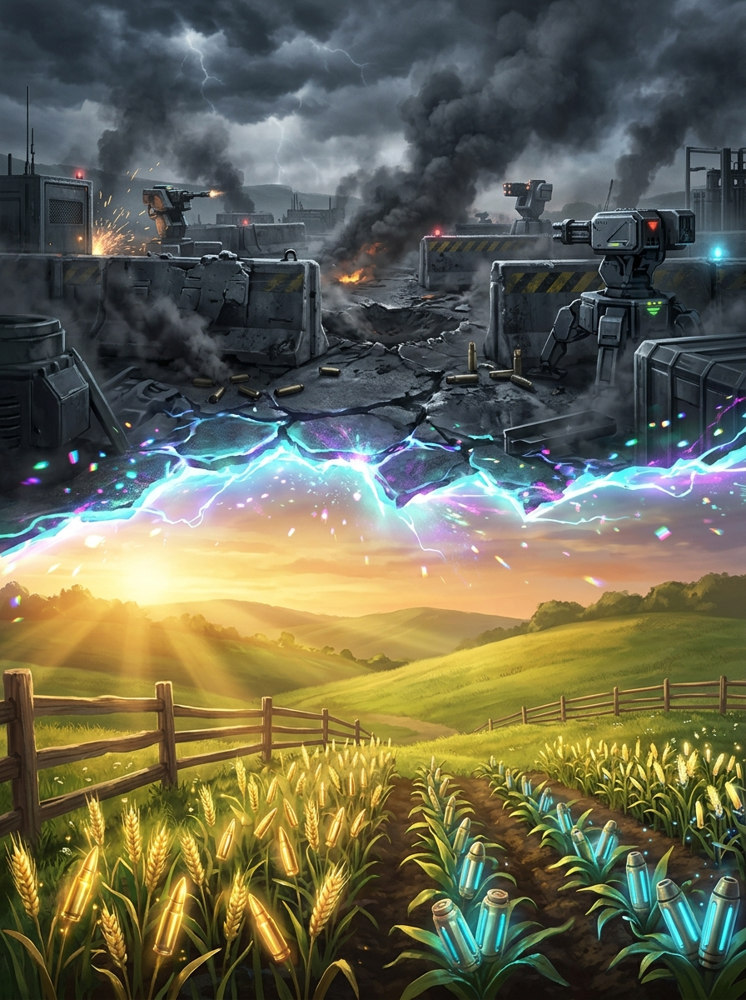

# Asset Designer & 3D Modeling Visual Reference Guide

**Project**: `GameJam_Shift_2026`  
**Target Audience**: 3D Asset Designer, Texture Artist, Environment Artist, and Blueprint Teammate  
**Location**: `Team/Asset_References/`

---

## 🎨 Creative Philosophy: "Combat Meets Agriculture"

In *GameJam Shift 2026*, the core fantasy is that the player fights for survival in an intense tactical combat world (`Z = 0`) and shifts into a surreal, tranquil farming world (`Z = -20,000`) where **ammunition, weapons, and medical supplies are cultivated like organic crops**.

---

## 🌽 1. Shotgun Shell Corn (`BP_Crop_ShotgunCorn`)

### Concept Art Reference


### 3D Modeling & Animation Specifications
* **Visual Concept**: A robust green maize stalk. When peeled, the ear reveals realistic red 12-gauge shotgun shells aligned in organic rows with brass rim bases firmly attached to the central cob core.
* **Growth Stages**:
  * **Stage 1 (Planted/Sprout)**: Small twin-leaf seedling emerging from dark soil.
  * **Stage 2 (Growing)**: Knee-high leafy corn stalk with tightly wrapped green silk husks.
  * **Stage 3 (Mature/Harvestable)**: Full-height ($1.8\text{m}$) stalk with peeled green husks prominently exposing glowing red shotgun shell cobs.
* **Material & Textures**:
  * *Husk/Leaves*: Translucent subsurface scattering green organic leaf material.
  * *Shells*: Glossy red ribbed polymer plastic with metallic brass gold rims (`Metallic = 1.0`, `Roughness = 0.25`).
* **Yield Item ID**: `"Ammo_Shotgun_12G"` / `"Item_Ammo_Shotgun"`.
* **Harvest Yield**: $+8$ shells (stacks up to 20 per $1\times 1$ Tarkov backpack cell).

---

## 🌾 2. Rifle Ammo Wheat (`BP_Crop_RifleWheat`)

### Concept Art Reference


### 3D Modeling & Animation Specifications
* **Visual Concept**: Golden wheat stalks swaying in the wind. The individual grains on the spikelets are sleek 5.56mm brass rifle bullets arranged naturally along the central rachis, surrounded by delicate golden awns/whiskers.
* **Growth Stages**:
  * **Stage 1 (Sprout)**: Fine emerald green grass-like shoots.
  * **Stage 2 (Growing)**: Waist-high green wheat ears with immature brass bullet buds.
  * **Stage 3 (Mature)**: Golden amber stalk, heavy drooping ears revealing polished 5.56mm rifle ammunition.
* **Material & Textures**:
  * *Stem/Husks*: Dry golden straw material (`Roughness = 0.7`).
  * *Bullets*: Highly reflective polished brass casing with copper bullet tips (`Metallic = 0.95`, `Roughness = 0.15`).
* **Yield Item ID**: `"Ammo_Rifle_556"` / `"Item_Ammo_Rifle"`.
* **Harvest Yield**: $+30$ rounds (stacks up to 60 per $1\times 1$ Tarkov backpack cell).

---

## 🍇 3. 9mm Pistol Ammo Vine (`BP_Crop_PistolBerry`)

### Concept Art Reference


### 3D Modeling & Animation Specifications
* **Visual Concept**: Climbing ivy/grape vine wrapped around wooden stakes or small trellises. Hanging down in clusters beneath broad heart-shaped leaves are clusters of gleaming 9mm Luger cartridges hanging by green stems like grapes.
* **Growth Stages**:
  * **Stage 1 (Sprout)**: Small twining green tendril wrapping around a wooden stake.
  * **Stage 2 (Growing)**: Dense leafy bush with small green unripe bullet buds.
  * **Stage 3 (Mature)**: Heavy hanging bunches of golden 9mm brass cartridges ready for harvest.
* **Material & Textures**:
  * *Leaves*: Deep emerald green waxy foliage.
  * *Stems*: Woody fibrous vine tendrils.
  * *Cartridges*: Brass casing with stamped primer indentations on the rear rims.
* **Yield Item ID**: `"Ammo_Pistol_9mm"` / `"Item_Ammo_Pistol"`.
* **Harvest Yield**: $+25$ rounds (stacks up to 50 per $1\times 1$ Tarkov backpack cell).

---

## 🌿 4. Medicinal Herb / Medkit Plant (`BP_Crop_MedHerb`)

### Concept Art Reference


### 3D Modeling & Animation Specifications
* **Visual Concept**: An exotic restorative botanical herb. Broad succulent leaves with crimson cross-patterned vascular veins. The blooming flowers resemble transparent bioluminescent capsules or medical ampoules glowing with soothing green and crimson healing nectar.
* **Growth Stages**:
  * **Stage 1 (Sprout)**: Small rosette of succulent leaves with faint red veins.
  * **Stage 2 (Growing)**: Tall herbal stem with closed cylindrical medical buds.
  * **Stage 3 (Mature)**: Fully bloomed glowing flower with bioluminescent restorative spores floating above.
* **Material & Textures**:
  * *Leaves*: Jade green succulent skin with emissive red vein glow (`EmissiveIntensity = 2.0`).
  * *Flower*: Translucent glass-like medical petal shader with glowing healing liquid interior.
* **Yield Item ID**: `"Item_Medkit"` / `"Medkit"`.
* **Harvest Yield**: $+1$ Medkit (consumable with key `H` to restore $+50\text{ HP}$).

---

## 🛠️ 5. Post-Apocalyptic Tactical Farming Tools Set

### Concept Art Reference Sheet


### Modeling Breakdown
1. **Tactical Hoe (Tool `2`)**:
   * *Blade*: Modified military entrenching shovel head welded to a steel tube shaft.
   * *Handle*: Textured combat rubber and olive-drab paracord grip.
   * *Function*: Tills soil plots, clearing weeds and preparing empty soil.
2. **Combat Watering Can (Tool `3`)**:
   * *Body*: Re-purposed 10-liter military fuel jerrycan / canteen finished in matte OD green with yellow stenciled markings.
   * *Spout*: Curved brass piping ending in a wide perforated rose sprinkler nozzle.
   * *Function*: Pours water onto dry planted crops to trigger growth timer.
3. **Harvester Sickle (Tool `4`)**:
   * *Blade*: High-carbon steel curved sickle blade with serrated tactical back edge.
   * *Handle*: Finger-grooved tactical grip with rear lanyard retention ring.
   * *Function*: Reaps mature crops with satisfying harvest pop effect.

---

## 🌌 6. Dual World Dimension Shift - Split Reality Key Art

### Concept Art Reference


### World Contrast Guidelines
| Feature | Combat Dimension (`Z = 0`) | Farming Dimension (`Z = -20,000`) |
|---|---|---|
| **Palette** | Desaturated concrete grays, gunmetal steel, emergency red alarms | Golden sunlight, lush greens, rich terracotta brown soil |
| **Atmosphere** | Overcast, stormy clouds, battlefield smoke, flickering floodlights | Blue skies, golden hour sun shafts, gentle wind, floating pollen |
| **Audio** | Gunshots, bullet snaps, metallic reload clicks, dark combat drone | Birdsong, breeze through trees, water streams, peaceful acoustic music |
| **Gameplay** | Fast-paced FPS survival, cover shooting, ammo expenditure | Relaxing farming loop, resource cultivation, tool cycling |

---

## 📂 File Deliverables & Organization

Place all imported `.uasset` files into their designated subdirectories in `Content/Dev_Blueprint/`:

```
Content/Dev_Blueprint/
├── Crops/
│    ├── Meshes/          (SM_Corn_Sprout, SM_Corn_Mature, SM_Wheat_Mature, etc.)
│    ├── Materials/       (M_CornHusk, M_BrassBullet, M_GlowingHerbal)
│    └── Blueprints/      (BP_Crop_ShotgunCorn, BP_Crop_RifleWheat, BP_Crop_MedHerb)
│
├── Tools/
│    ├── Meshes/          (SM_TacticalHoe, SM_JerrycanWaterCan, SM_TacticalSickle)
│    └── Materials/       (M_TacticalMetal, M_JerrycanODGreen)
│
├── VFX/
│    ├── NS_DimensionShift (Portal ripple Niagara system)
│    ├── NS_WaterSpray     (Watering can nozzle splash)
│    └── NS_CropMatureSparkle (Golden glow ready prompt)
│
└── Audio/
     ├── Cue_DimensionShift (Ethereal electric whoosh)
     ├── Cue_Hoe_Till       (Crunchy dirt scoop)
     ├── Cue_Water_Pour     (Gentle water stream)
     └── Cue_HarvestPop     (Crisp pop sound)
```
